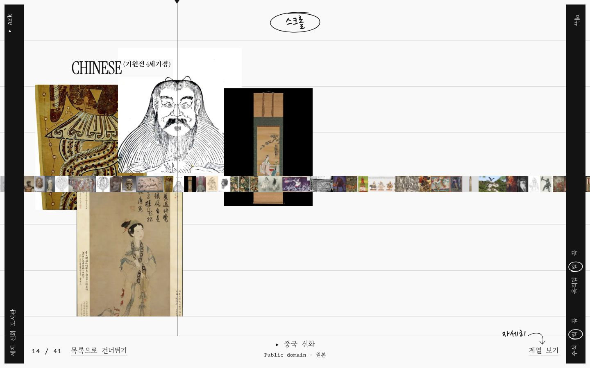
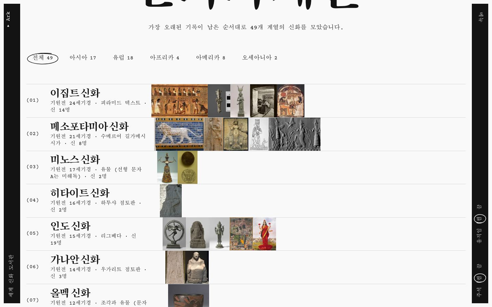
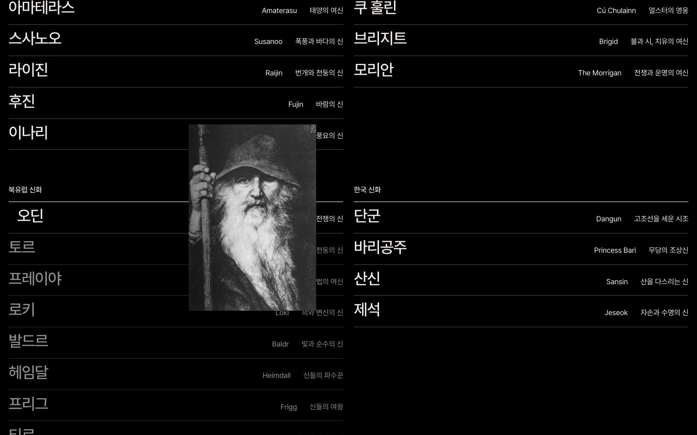
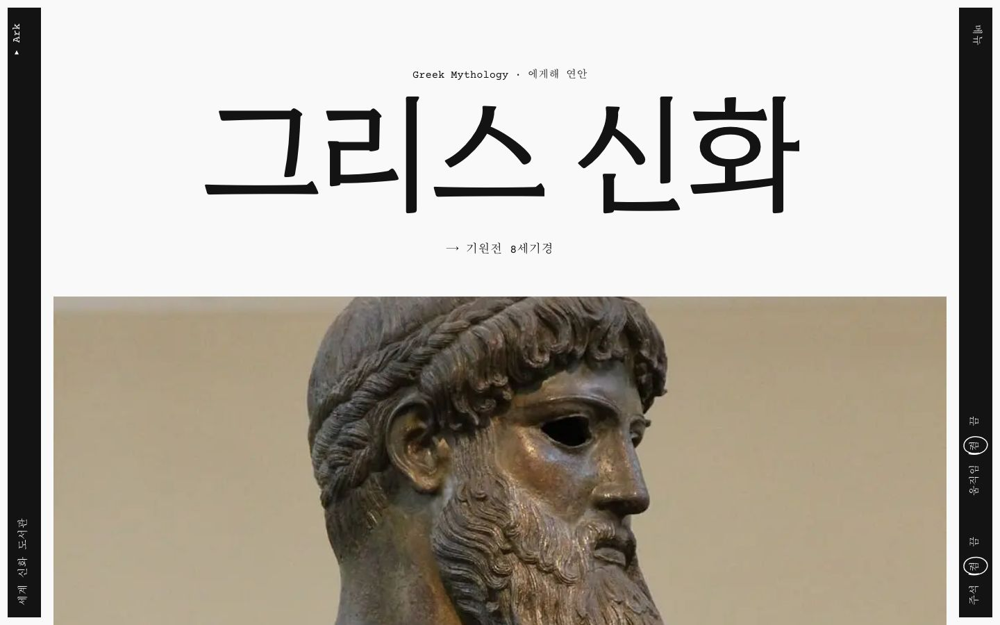
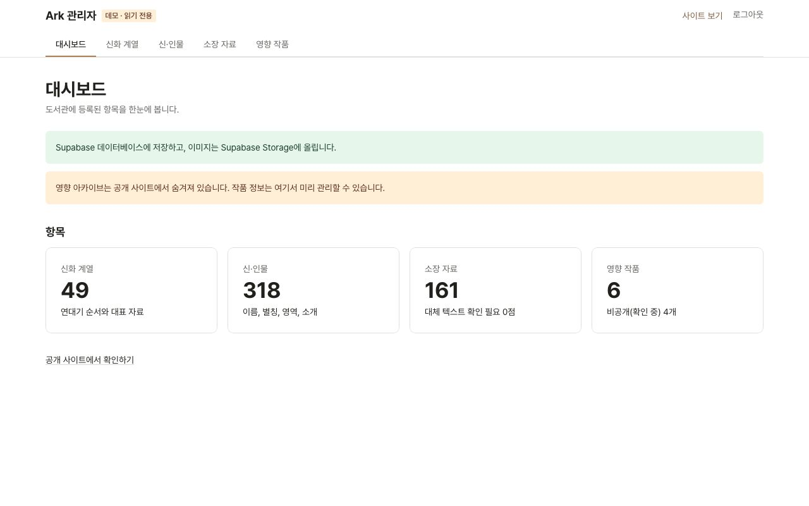
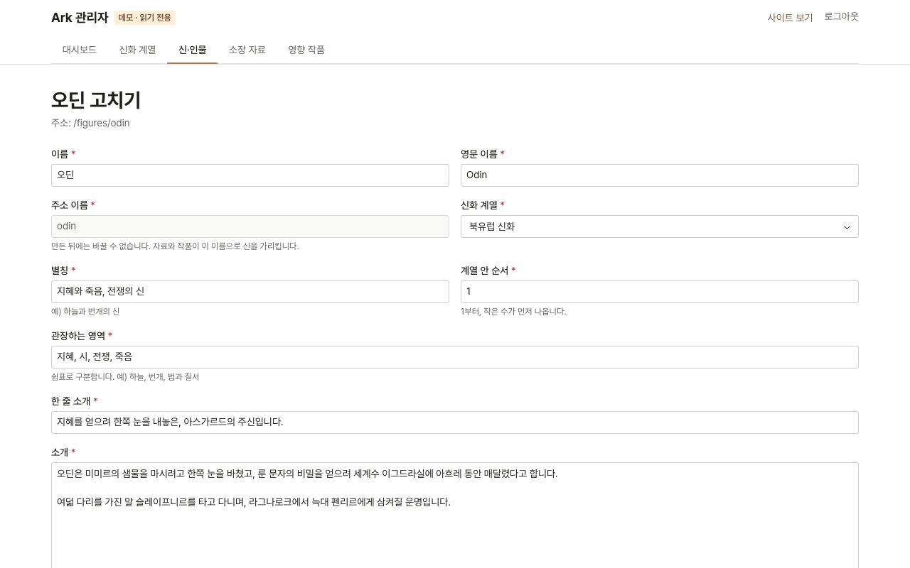
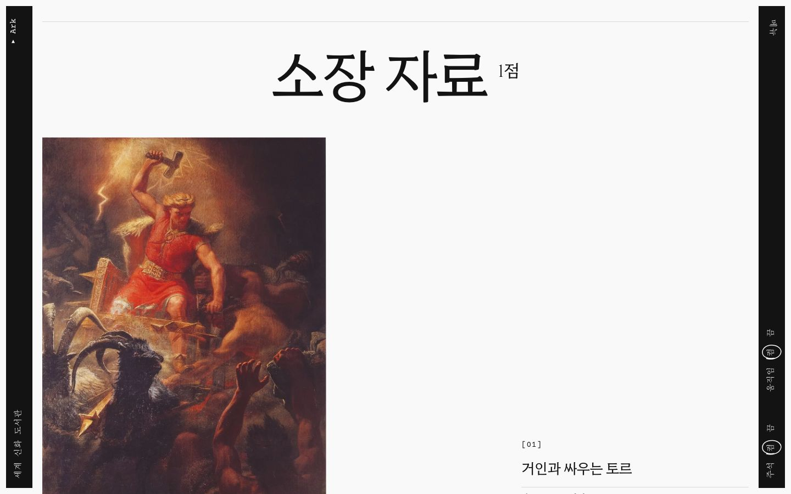
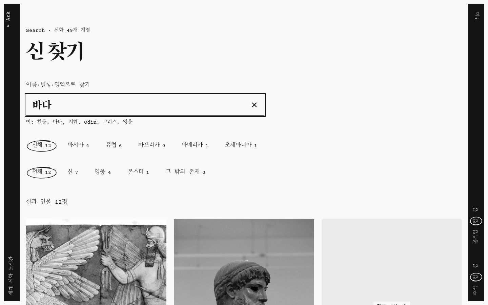
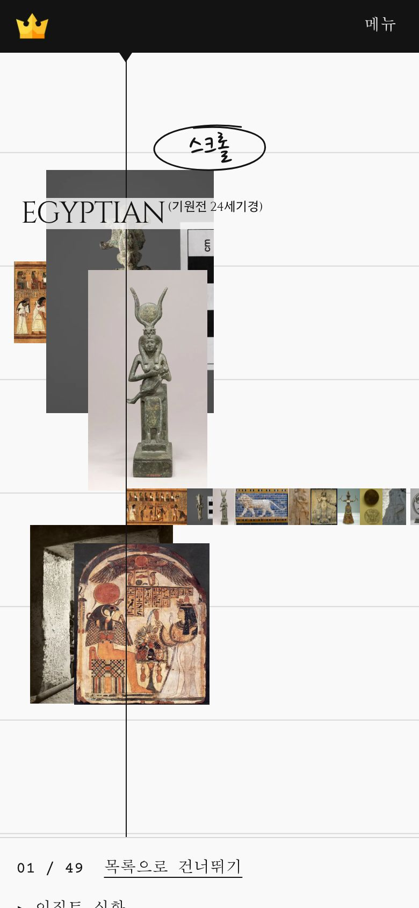
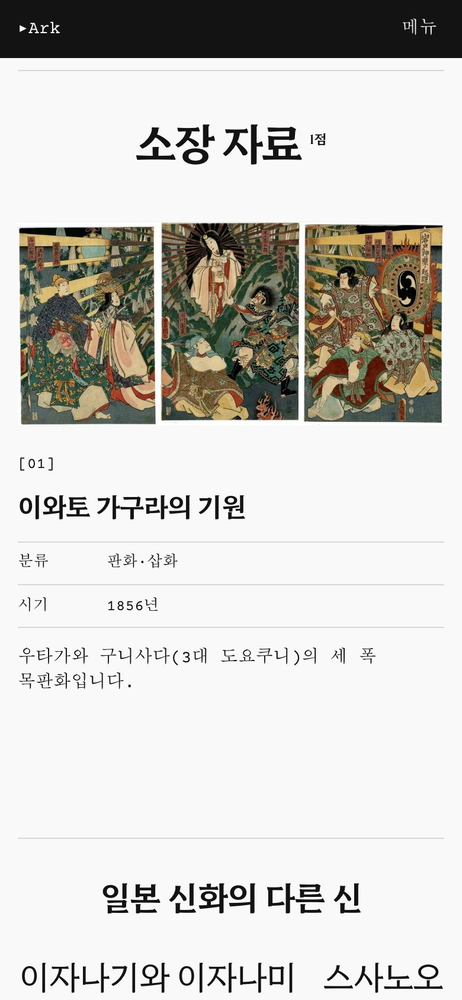

# Ark - 세계 신화 도서관

[](https://github.com/ryushin01/Ark/actions/workflows/ci.yml)


다섯 대륙 49개 신화·전설 계열의 신과 영웅, 몬스터 322명을 조각상, 회화, 유물 자료 293점으로 살펴보는 세계 신화 도서관입니다.

**[데모 바로 보기](https://ark-ryushin01.vercel.app/)** · 어드민은 [/admin](https://ark-ryushin01.vercel.app/admin)에서 **데모 계정으로 둘러보기**를 누르면 됩니다. · **[디자인 시스템(Storybook)](https://ark-ryushin01.vercel.app/storybook/index.html)**

> **프로젝트 상태:** 개발 중인 **포트폴리오 프로젝트**입니다. 데이터와 업로드 이미지는 Supabase(Postgres, Storage)에 저장하고, 환경 변수가 없으면 메모리 목업으로 동작합니다. 자료 이미지는 모두 Wikimedia Commons의 퍼블릭 도메인·CC 라이선스 자료이며, 이미지마다 저작자와 라이선스를 표기했습니다.

## 화면

| 첫 화면                                                                                                             | 신화 계열 목록                                                                          |
| ------------------------------------------------------------------------------------------------------------------- | --------------------------------------------------------------------------------------- |
|  |  |

| 신 색인                                                                                        | 계열 상세                                                                                  |
| ---------------------------------------------------------------------------------------------- | ------------------------------------------------------------------------------------------ |
|  |  |

| 어드민 대시보드                                                                                                                     | 어드민 편집                                                                            |
| ----------------------------------------------------------------------------------------------------------------------------------- | -------------------------------------------------------------------------------------- |
|  |  |

| 신 상세                                                                                   | 신 찾기                                                                                                            |
| ----------------------------------------------------------------------------------------- | ------------------------------------------------------------------------------------------------------------------ |
|  |  |

| 모바일 홈                                                                                                  | 모바일 신 상세                                                                                                      |
| ---------------------------------------------------------------------------------------------------------- | ------------------------------------------------------------------------------------------------------------------- |
|  |  |

## 주요 기능

| 화면          | 내용                                                                                                                                                                             |
| ------------- | -------------------------------------------------------------------------------------------------------------------------------------------------------------------------------- |
| 홈            | 악보를 닮은 첫 화면(스크롤하면 자료 필름이 흐르고 재생선 위 계열이 콜라주로 펼쳐짐), 오선 한 줄마다 계열을 놓은 목록과 대륙 거르기, 마우스를 따라다니는 미리보기가 있는 신 색인  |
| 계열 상세     | 계열 소개, 대표 자료, 속한 신 목록, 신들의 계보(배우자와 자식, Ark에 있는 신으로 연결), 다음 계열로 이동                                                                         |
| 신 찾기       | 이름·별칭·관장 영역으로 찾고 대륙과 분류(신·영웅·몬스터·그 밖의 존재, 몬스터는 신수·영수·몬스터 등급)로 거르기. 결과 개수를 화면 낭독기에 알리고, 검색 상태를 주소로 공유합니다. |
| 신 상세       | 별칭과 관장 영역, 소개, 가족(부모·배우자·자식·형제자매), 탈것·동반자, 소장 자료(분류·시기·소장처·해석 메모), 같은 계열의 다른 신                                                 |
| 어드민        | 계열·신·자료·작품·계보 관리와 이미지 업로드(Radix Themes). 관리자 비밀번호로 로그인하면 저장할 수 있고, 데모 계정은 둘러보기만 합니다. 저장하면 공개 화면에 바로 반영됩니다.     |
| 영향 아카이브 | 신화의 영향을 받은 게임·애니메이션·소설을 스와이프 갤러리로 보여 줍니다. 작품 이미지의 저작권을 확인하기 전까지 기능 플래그로 숨겨 둡니다.                                       |

화면을 옮길 때는 계층을 따라 들어가면 새 화면이 옆에서 밀려 들어오고(drill), 같은 깊이는 겹쳐 바뀝니다(fade). 모든 등장 애니메이션과 화면 전환은 동작 줄이기를 켜거나 세로 띠의 움직임 설정을 끄면 멈추고, 자바스크립트가 없어도 내용이 보입니다.

## 기술 스택


| 구분        | 사용 기술                                                                                                                                                               |
| ----------- | ----------------------------------------------------------------------------------------------------------------------------------------------------------------------- |
| 프레임워크  | Next.js 16 (App Router, Cache Components), React 19, TypeScript                                                                                                         |
| 구조        | Feature-Sliced Design v2.1                                                                                                                                              |
| 스타일·연출 | CSS Modules, Lenis(부드러운 스크롤), SSGOI(화면 전환), Cinzel·Hahmlet·Courier Prime(한글 본문은 운영체제 명조)                                                          |
| 어드민      | Radix Themes, Server Actions, zod, sharp(이미지 줄이기)                                                                                                                 |
| 품질        | ESLint(import 정렬, FSD 계층 규칙), Steiger(FSD 구조), Prettier, husky + lint-staged, Vitest + React Testing Library, Storybook 스토리 테스트(axe), Playwright E2E(axe) |
| 데이터      | Supabase (Postgres, RLS, Storage), Vercel Cron(무료 프로젝트 깨우기)                                                                                                    |
| 문서        | Storybook 10 (`@storybook/nextjs-vite`)                                                                                                                                 |

## 시작하기

Node.js 22(`.nvmrc`)와 pnpm이 필요합니다.

```bash
nvm use
corepack enable pnpm
pnpm install
cp .env.example .env.local   # 로컬 Supabase 값으로 채웁니다 (아래)
pnpm db:start                # 로컬 Supabase (Docker 필요, 마이그레이션·시드 자동 적용)
pnpm dev                     # http://localhost:3000, 어드민은 /admin
```

`pnpm db:start`가 출력하는 `API_URL`과 `SECRET_KEY`를 `.env.local`의 `SUPABASE_URL`, `SUPABASE_SECRET_KEY`에 넣고 `ADMIN_PASSWORD`를 정합니다. 비워 두면 메모리 목업으로 동작하고, 어드민은 **데모 계정으로 둘러보기**로 들어갈 수 있습니다. 로컬 개발은 운영 데이터베이스를 쓰지 않습니다. `.env.local`에 로컬 Supabase를 적었다면 `pnpm build` 전에도 `pnpm db:start`가 필요합니다.

| 명령                                     | 설명                                                          |
| ---------------------------------------- | ------------------------------------------------------------- |
| `pnpm build` / `pnpm start`              | 프로덕션 빌드 / 실행                                          |
| `pnpm storybook`                         | Storybook 개발 서버 (`http://localhost:6006`)                 |
| `pnpm lint` / `pnpm lint:fsd`            | ESLint / FSD 구조 검사(Steiger)                               |
| `pnpm typecheck`                         | 타입 검사                                                     |
| `pnpm test`                              | 단위 테스트                                                   |
| `pnpm test:storybook`                    | 모든 스토리 렌더링과 접근성 검사                              |
| `pnpm test:e2e`                          | 프로덕션 빌드의 실제 화면 검사 (먼저 `build` 필요)            |
| `pnpm test:e2e:local-db`                 | 이미지 업로드 E2E (로컬 Supabase 필요)                        |
| `pnpm db:push` / `pnpm db:seed:generate` | Supabase 마이그레이션 적용 / 시드 SQL 만들기                  |
| `pnpm images:resolve`                    | Wikimedia Commons에서 자료 이미지와 라이선스 정보를 다시 받기 |

환경 변수와 전체 규칙은 [개발 가이드](docs/development.md)를 참고하세요.

## 프로젝트 구조

```
e2e/               E2E 테스트와 README 스크린샷 촬영
public/images/     자료 이미지 (Wikimedia Commons)
scripts/           자료 이미지·라이선스 정보 받기, 시드 SQL 만들기
supabase/          마이그레이션(스키마·RLS·Storage), 시드
src/
├─ app/            Next.js 라우트 (_pages를 다시 내보내기만 함)
├─ _app/           루트·사이트·어드민 레이아웃, 전역 스타일
├─ _pages/         홈(악보 무대·계열 목록·신 색인), 계열, 신, 신 찾기, 아카이브, 404, 어드민 화면(편집 폼)
├─ widgets/        세로 띠와 메뉴, 바닥글, 신 카드 목록, 어드민 틀
├─ features/       어드민 로그인
├─ entities/       계열(pantheon), 신(figure), 자료(exhibit), 작품(work)
├─ shared/         등장 애니메이션 UI, 손글씨 주석, 어드민 입력 부품, 세션, 저장소(Supabase·목업)
└─ proxy.ts        /admin 접근 제어
```

## 문서

| 문서                               | 내용                                                                      |
| ---------------------------------- | ------------------------------------------------------------------------- |
| [개발 가이드](docs/development.md) | FSD 구조, 디자인 토큰, 데이터와 이미지, 어드민, 환경 변수, 접근성, 테스트 |
| [버전 기록](CHANGELOG.md)          | 버전별 변경 내용                                                          |
