# Ark - 세계 신화 도서관

[](https://github.com/ryushin01/Ark/actions/workflows/ci.yml)


다섯 대륙 여러 문명권의 51개 신화·전설 계열에서 신과 영웅, 몬스터 475명을 조각상, 회화, 유물, 사진 자료 561점으로 살펴보고, 신화 속 유물 152점을 비밀 전시실에 모은 세계 신화 도서관입니다.

**[데모 바로 보기](https://ark-ryushin01.vercel.app/)** · 어드민은 [/admin](https://ark-ryushin01.vercel.app/admin)에서 **데모 계정으로 둘러보기**를 누르면 됩니다. · **[디자인 시스템(Storybook)](https://ark-ryushin01.vercel.app/storybook/index.html)**

> **프로젝트 상태:** 실제 서비스 런칭을 가정해 다듬은 **v1.0.0 포트폴리오 프로젝트**입니다. 데이터와 업로드 이미지는 Supabase(Postgres, Storage)에 저장하고, 환경 변수가 없으면 메모리 목업으로 동작합니다. 자료 이미지는 모두 Wikimedia Commons의 퍼블릭 도메인·CC 라이선스 자료이며, 저작자와 라이선스는 아래 [출처](#출처)에 모았습니다.

## 화면

| 첫 화면                                                                                                             | 신화 계열 목록                                                                          |
| ------------------------------------------------------------------------------------------------------------------- | --------------------------------------------------------------------------------------- |
| 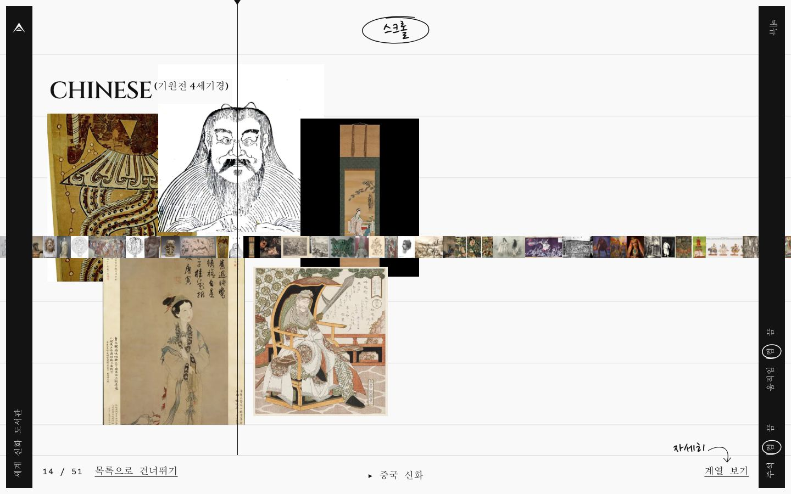 | 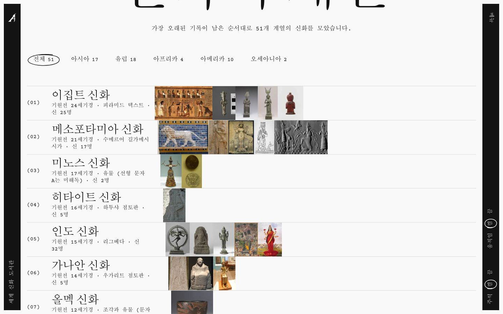 |

| 신 색인                                                                                        | 계열 상세                                                                                  |
| ---------------------------------------------------------------------------------------------- | ------------------------------------------------------------------------------------------ |
| 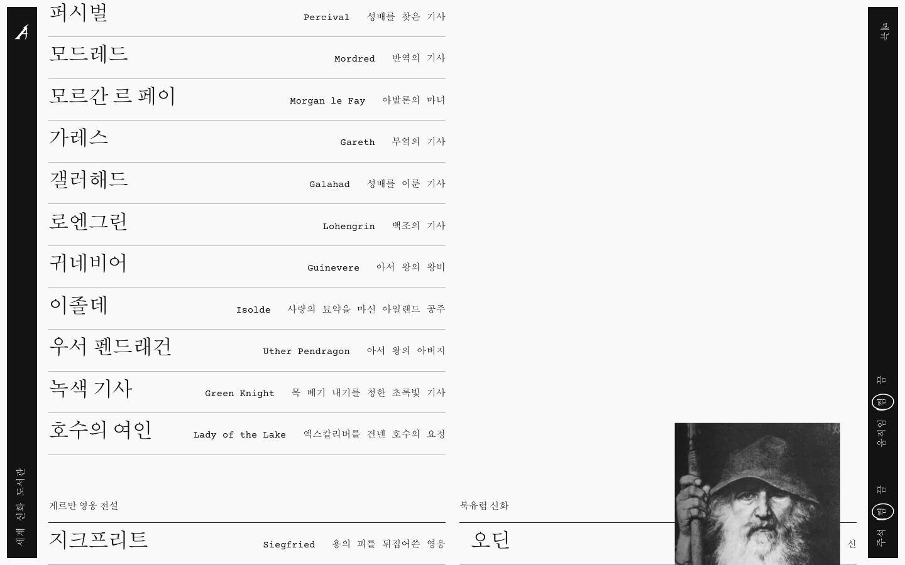 | 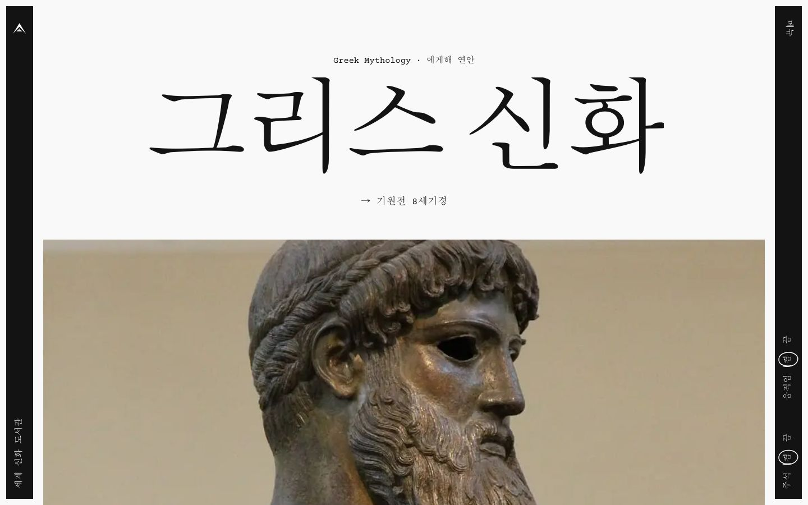 |

| 비밀 전시실                                                                                                                                                                 | 유물 상세                                                                                                                                                            |
| --------------------------------------------------------------------------------------------------------------------------------------------------------------------------- | -------------------------------------------------------------------------------------------------------------------------------------------------------------------- |
| 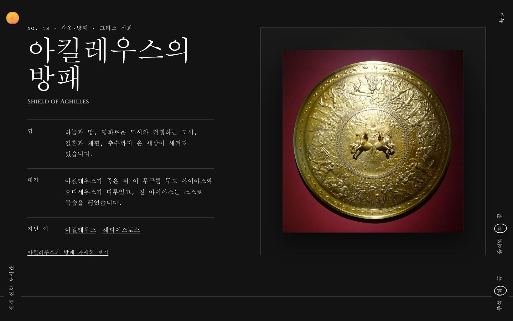 | 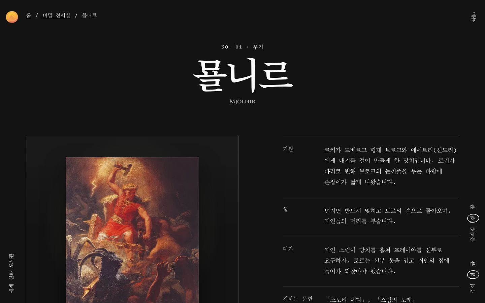 |

| 비밀 전시실 (휴대폰)                                                                                                                                          | 유물 상세 (휴대폰)                                                                                                                            |
| ------------------------------------------------------------------------------------------------------------------------------------------------------------- | --------------------------------------------------------------------------------------------------------------------------------------------- |
| 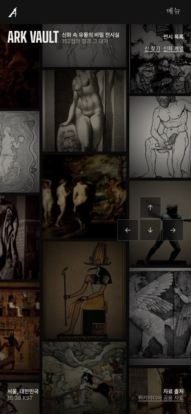 | 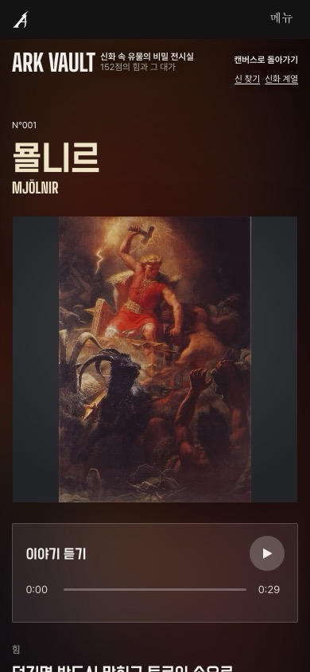 |

| 어드민 대시보드                                                                                                                                   | 어드민 편집                                                                            |
| ------------------------------------------------------------------------------------------------------------------------------------------------- | -------------------------------------------------------------------------------------- |
| 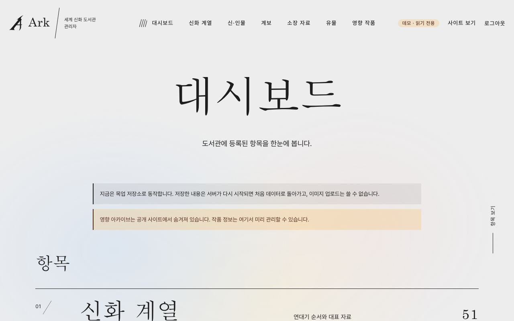 | 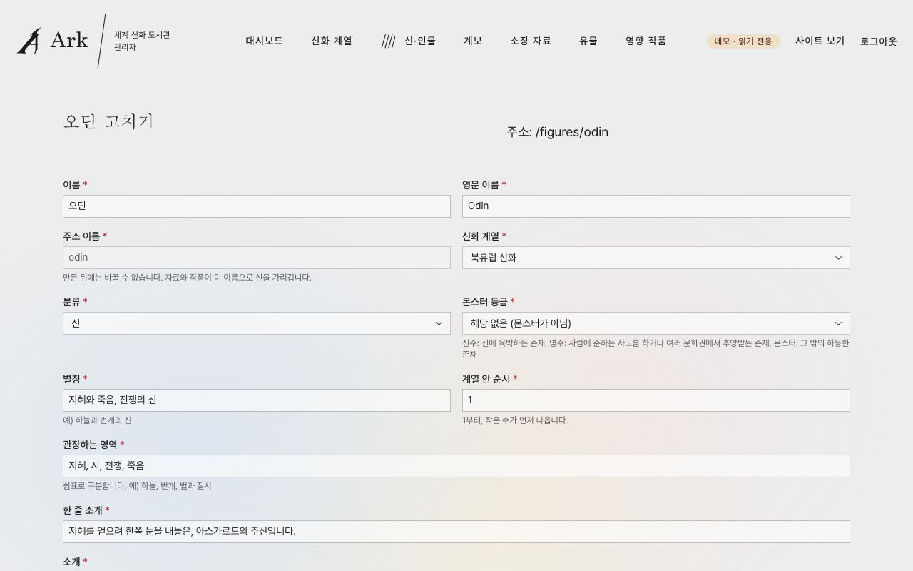 |

| 신 상세                                                                                             | 신 찾기                                                                                                                                                                |
| --------------------------------------------------------------------------------------------------- | ---------------------------------------------------------------------------------------------------------------------------------------------------------------------- |
| 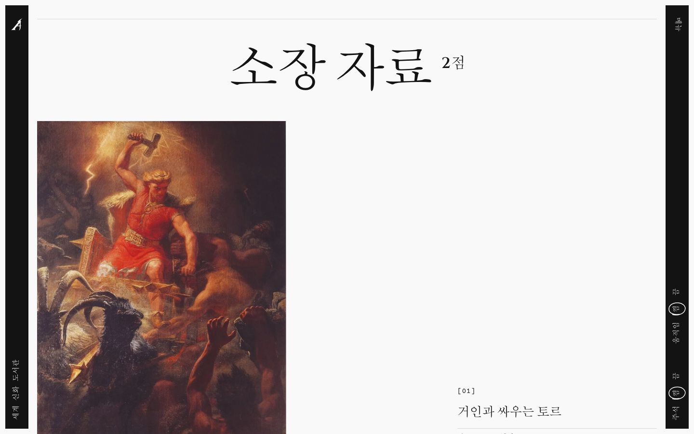 | 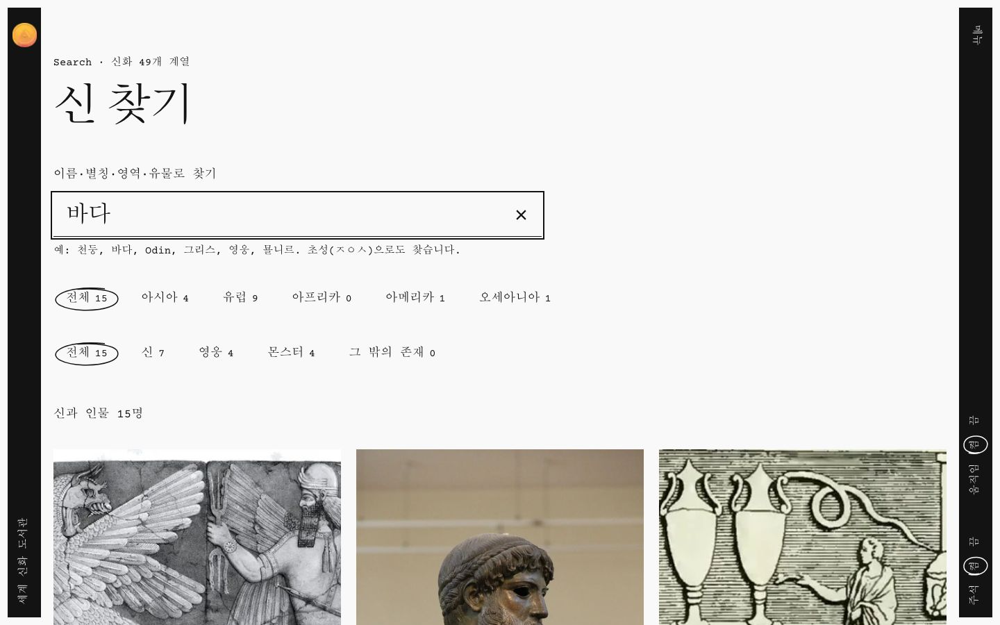 |

| 모바일 홈                                                                                                  | 모바일 신 상세                                                                                          |
| ---------------------------------------------------------------------------------------------------------- | ------------------------------------------------------------------------------------------------------- |
| 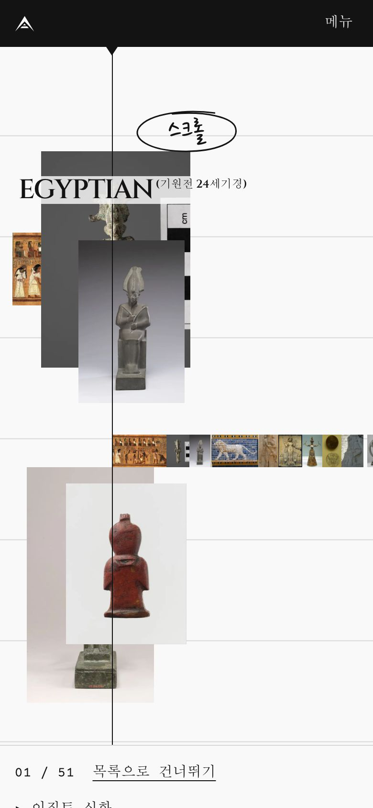 | 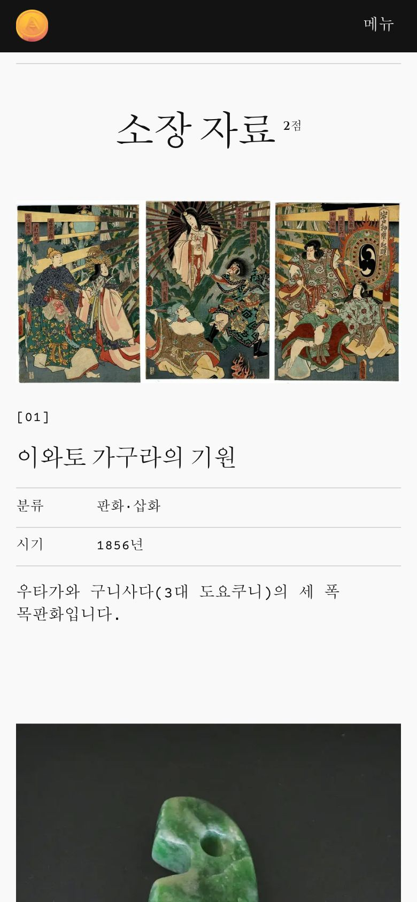 |

## 주요 기능

| 화면          | 내용                                                                                                                                                                                                                                                                                                                                                                             |
| ------------- | -------------------------------------------------------------------------------------------------------------------------------------------------------------------------------------------------------------------------------------------------------------------------------------------------------------------------------------------------------------------------------- |
| 홈            | 악보를 닮은 첫 화면(스크롤하면 자료 필름이 흐르고 재생선 위 계열이 콜라주로 펼쳐짐), 오선 한 줄마다 계열을 놓은 목록과 대륙 거르기, 마우스를 따라다니는 미리보기가 있는 신 색인                                                                                                                                                                                                  |
| 계열 상세     | 계열 소개, 대표 자료, 속한 신 목록, 신들의 계보(배우자와 자식, Ark에 있는 신으로 연결), 다음 계열로 이동                                                                                                                                                                                                                                                                         |
| 신 찾기       | 이름·별칭·관장 영역·지닌 유물(묠니르 → 토르)로 찾고, 초성(ㅈㅇㅅ)과 입력하는 중인 글자로도 찾기. 대륙과 분류(신·영웅·몬스터·그 밖의 존재, 몬스터는 신수·영수·몬스터 등급)로 거르기. 결과 개수를 화면 낭독기에 알리고, 검색 상태를 주소로 공유합니다.                                                                                                                             |
| 신 상세       | 별칭과 관장 영역, 소개, 가족(부모·배우자·자식·형제자매), 탈것·동반자, 지닌 유물, 소장 자료(분류·시기·소장처·해석 메모), 같은 계열의 다른 신                                                                                                                                                                                                                                      |
| 비밀 전시실   | 묠니르·아이기스·구사나기의 검·천부인·성배처럼 신과 영웅이 쥐었던 신화 속 유물 152점. 유물 그림을 벽돌형으로 깐 무한 캔버스를 끌기·휠·방향키·버튼으로 둘러보고, 신화 계열별 전시 목록도 엽니다. 유물 상세는 흐린 그림 배경 위에 큰 이름과 진열 패널, 힘과 그 힘이 치르게 한 대가·기원·문헌·지닌 이를 보여 주고, 설명을 브라우저 음성 합성으로 읽어 주는 ‘이야기 듣기’가 있습니다. |
| 어드민        | 계열·신·자료·유물·작품·계보 관리와 이미지 업로드(Radix Themes, 밝은 회색 종이와 큰 세리프 제목의 도록 같은 화면). 관리자 비밀번호로 로그인하면 저장할 수 있고, 데모 계정은 둘러보기만 합니다. 저장하면 공개 화면에 바로 반영됩니다.                                                                                                                                              |
| 영향 아카이브 | 신화의 영향을 받은 게임·애니메이션·소설을 스와이프 갤러리로 보여 줍니다. 작품 이미지의 저작권을 확인하기 전까지 기능 플래그로 숨겨 둡니다.                                                                                                                                                                                                                                       |

**소식 피드:** 새 버전 소식(변경 기록)을 RSS 2.0으로 냅니다. 주소는 `/feed.xml`이고(운영 https://ark-ryushin01.vercel.app/feed.xml), 모든 화면의 `<head>`에 자동 발견 링크가 들어 있어 피드 리더에 사이트 주소만 넣어도 찾습니다. 최근 30개 릴리스를 싣고, 빌드할 때 한 번 만들어 정적으로 내보내므로 오프라인으로 빌드·실행해도 같습니다.

화면을 옮길 때는 계층을 따라 들어가면 새 화면이 옆에서 밀려 들어오고(drill), 같은 깊이는 겹쳐 바뀝니다(fade). 모든 등장 애니메이션과 화면 전환은 동작 줄이기를 켜거나 세로 띠의 움직임 설정을 끄면 멈추고, 자바스크립트가 없어도 내용이 보입니다.

## 기술 스택


| 구분        | 사용 기술                                                                                                                                                                                                                  |
| ----------- | -------------------------------------------------------------------------------------------------------------------------------------------------------------------------------------------------------------------------- |
| 프레임워크  | Next.js 16 (App Router, Cache Components), React 19, TypeScript                                                                                                                                                            |
| 구조        | Feature-Sliced Design v2.1                                                                                                                                                                                                 |
| 스타일·연출 | CSS Modules, Lenis(부드러운 스크롤), SSGOI(화면 전환), 웹 폰트 Cinzel·Courier Prime(영문)·바탕(한글 제목·본문), 비밀 전시실은 Big Shoulders Display·도현·Pretendard                                                        |
| 데이터 가공 | Lodash(`lodash-es`, 함수별로 가져와 트리 셰이킹)                                                                                                                                                                           |
| 어드민      | Radix Themes, Server Actions, zod, sharp(이미지 줄이기)                                                                                                                                                                    |
| 품질        | ESLint(import 정렬, FSD 계층 규칙), Steiger(FSD 구조), Prettier, husky + lint-staged, Vitest + React Testing Library, Storybook 스토리 테스트(axe), Playwright E2E(axe), eslint-plugin-jsx-a11y, size-limit, Lighthouse CI |
| 모니터링    | Sentry(DSN이 있을 때만, 같은 출처 터널과 서버 오류 수집), web-vitals                                                                                                                                                       |
| 데이터·배포 | Supabase (Postgres, RLS, Storage), Vercel Cron(무료 프로젝트 깨우기), GitHub Actions 운영 반영(마이그레이션 → 콘텐츠 → 배포)                                                                                               |
| 문서        | Storybook 10 (`@storybook/nextjs-vite`)                                                                                                                                                                                    |

## 시작하기

Node.js 22(`.nvmrc`)와 pnpm이 필요합니다.

```bash
nvm use
corepack enable pnpm
pnpm install
cp .env.example .env.local   # 로컬 Supabase 값으로 채웁니다 (아래)
pnpm db:start                # 로컬 Supabase (Docker 필요, 마이그레이션·시드 자동 적용)
pnpm dev                     # http://localhost:3000, 어드민은 /admin
```

`pnpm db:start`가 출력하는 `API_URL`과 `SECRET_KEY`를 `.env.local`의 `SUPABASE_URL`, `SUPABASE_SECRET_KEY`에 넣고 `ADMIN_PASSWORD`를 정합니다. 비워 두면 메모리 목업으로 동작하고, 어드민은 **데모 계정으로 둘러보기**로 들어갈 수 있습니다. 로컬 개발은 운영 데이터베이스를 쓰지 않습니다. `.env.local`에 로컬 Supabase를 적었다면 `pnpm build` 전에도 `pnpm db:start`가 필요합니다.

| 명령                                     | 설명                                                                       |
| ---------------------------------------- | -------------------------------------------------------------------------- |
| `pnpm build` / `pnpm start`              | 프로덕션 빌드 / 실행                                                       |
| `pnpm storybook`                         | Storybook 개발 서버 (`http://localhost:6006`)                              |
| `pnpm lint` / `pnpm lint:fsd`            | ESLint / FSD 구조 검사(Steiger)                                            |
| `pnpm typecheck`                         | 타입 검사                                                                  |
| `pnpm check`                             | CI와 같은 검사를 한 번에 (`pnpm check static build`처럼 묶음만도 가능)     |
| `pnpm test`                              | 단위 테스트                                                                |
| `pnpm test:coverage`                     | 단위 테스트 커버리지 (로직 계층 80%, 전체 기준선)                          |
| `pnpm test:storybook`                    | 모든 스토리 렌더링과 접근성 검사                                           |
| `pnpm test:e2e`                          | 프로덕션 빌드의 실제 화면 검사 (먼저 `build` 필요)                         |
| `pnpm test:e2e:offline`                  | 외부 요청을 막고 비밀 값 없이 모든 화면이 뜨는지 검사 (먼저 `build` 필요)  |
| `pnpm test:visual`                       | 주요 화면·스토리 시각 회귀 (Linux 기준 이미지, 먼저 `build` 필요)          |
| `pnpm test:vitals`                       | 무거운 화면의 LCP·CLS·INP 검사 (먼저 `build` 필요)                         |
| `pnpm size` / `pnpm lhci`                | 번들 크기 예산 / Lighthouse 점수 기준 검사 (먼저 `build` 필요)             |
| `pnpm load:local-db`                     | 로컬 Supabase 읽기 부하 측정 (로컬 주소에서만 돎)                          |
| `pnpm test:e2e:local-db`                 | 이미지 업로드 E2E (로컬 Supabase 필요)                                     |
| `pnpm db:push` / `pnpm db:seed:generate` | Supabase 마이그레이션 적용 / 시드 SQL 만들기                               |
| `pnpm images:resolve`                    | Wikimedia Commons에서 자료 이미지와 라이선스 정보를 다시 받기              |
| `pnpm credits`                           | 자료 데이터에서 그림 출처 전체 목록(`docs/credits.md`) 다시 만들기         |
| `pnpm fonts`                             | 한글 웹 폰트(바탕) 화면 글자 파일과 조각 다시 만들기 (화면 글자를 바꾼 뒤) |

### 품질 검사

`pnpm check` 하나로 CI와 같은 검사를 로컬에서 돌립니다(유료 도구 없음). CI는 작업마다 같은 스크립트의 묶음을 부릅니다.

- **커버리지:** `@vitest/coverage-v8`. 로직 계층(`shared/lib`, 슬라이스의 `model`·`api`)은 80% 이상, 전체는 기준선 아래로 내려가지 않게 막습니다. CI 작업 요약에 커버리지 표를 적습니다.
- **시각 회귀:** Playwright `toHaveScreenshot`으로 주요 화면 9곳(데스크톱·모바일)과 모든 Storybook 스토리를 비교합니다. 움직임·화면 전환·부드러운 스크롤을 멈추고 글꼴을 다 받은 뒤 찍으며, 기준 이미지는 Playwright 공식 Docker 이미지(Linux CI)에서 만듭니다.
- **성능:** 번들 크기(size-limit)·Lighthouse 기준은 그대로 두고, 무거운 화면 4곳은 실제 조작 뒤 LCP·CLS·INP를 잽니다. 백엔드 부하는 로컬 Supabase에서만 잽니다(`pnpm load:local-db`).
- **접근성:** 모든 화면과 주요 상태(대화상자·필터·결과 없음·오류 안내)를 axe로 검사하고, Storybook a11y 위반은 오류로 실패합니다.
- **CI:** 빌드를 한 번만 하고 결과물을 E2E(세 조각)·시각 회귀·Lighthouse가 받아 씁니다. pnpm·`.next/cache`·Playwright 브라우저를 캐시하고, 새 커밋이 오면 이전 실행을 취소하며, Markdown만 바뀌면 무거운 검사를 건너뜁니다. 실패할 때만 Playwright 리포트·차이 이미지를 7일 보관합니다.

자세한 내용은 [개발 가이드](docs/development.md)의 "CI와 의존성"·"테스트"를 참고하세요.

### 비밀 값 없이·오프라인으로 실행

`.env.local` 없이 `pnpm install` → `pnpm dev`(또는 `pnpm build` → `pnpm start`)만 해도 저장소에 든 시드 데이터(메모리 목업)와 그림(`public/images/exhibits/`), 글꼴(`src/_app/styles/fonts/`)로 모든 화면이 뜹니다. 인터넷이 끊겨도 됩니다. 어드민은 **데모 계정으로 둘러보기**로 들어갑니다.

Supabase를 설정했는데 닿지 않으면(오프라인, 5초 시간 초과, 오류 응답) 읽기는 내장 시드 데이터로 대신 보여 주고, 화면 위에 "오프라인 데이터로 표시 중" 안내(`role="status"`)를 띄웁니다. 저장은 대신하지 않고 실패합니다. 오류 수집(Sentry)은 DSN이 있을 때만 켜지고, 보내지 못해도 화면에 영향을 주지 않습니다.

그림을 받지 못하면(어드민에서 올린 그림의 Supabase Storage가 끊기거나 이미지 최적화가 막힐 때) 깨진 그림 대신 저장소 안의 흐린 자리 표시(`public/images/placeholder.svg`, `SafeImage`)를 같은 크기로 보여 줍니다. 대체 텍스트는 그대로 둡니다. 화면은 외부 글꼴·스크립트·그림을 쓰지 않습니다(CSP가 같은 출처만 허용).

`pnpm test:e2e:offline`은 브라우저의 localhost 밖 요청을 모두 막고, 메모리 목업 서버와 Supabase에 닿지 않는 서버(`SUPABASE_URL=https://supabase.invalid`) 두 곳에서 같은 검사를 합니다.

- 공개 화면: 홈 악보 무대·대륙별 계열, 신 찾기(검색 결과·필터 주소 공유), 계열, 계보, 인물 상세, 비밀 전시실·유물 상세, 없는 주소(404), 작은 화면
- 흐름: 홈 → 대륙 필터 → 계열 → 계보 → 신 상세, 신 찾기 → 주소 다시 열기 → 상세, 전시 목록 → 유물 상세
- 어드민: 데모 계정 입장, 대시보드, 모든 목록(계열·신·계보·자료·유물·영향 작품)과 편집·새 항목 화면
- 피드·사이트맵·robots, Storybook
- 화면마다 내용이 있는지, 오류 화면·끝나지 않는 로딩(`aria-busy`)·깨진 그림·화면 스크립트 오류·외부 요청이 없는지, axe(WCAG 2.2 AA) 위반이 없는지 봅니다. 자료 그림을 모두 막은 상태에서는 그림이 자리 표시로 바뀌는지도 봅니다.

환경 변수와 전체 규칙은 [개발 가이드](docs/development.md)를 참고하세요.

## 프로젝트 구조

```
e2e/               E2E 테스트와 README 스크린샷 촬영
public/images/     자료 이미지 (Wikimedia Commons)
scripts/           자료 이미지·라이선스 정보 받기, 시드 SQL·운영 콘텐츠 반영 SQL 만들기
supabase/          마이그레이션(스키마·RLS·Storage), 시드
src/
├─ app/            Next.js 라우트 (_pages를 다시 내보내기만 함)
├─ _app/           루트·사이트·어드민 레이아웃, 전역 스타일
├─ _pages/         홈(악보 무대·계열 목록·신 색인), 계열, 신, 신 찾기, 비밀 전시실, 아카이브, 404, 어드민 화면(편집 폼)
├─ widgets/        세로 띠와 메뉴, 바닥글, 신 카드 목록, 어드민 틀
├─ features/       어드민 로그인
├─ entities/       계열(pantheon), 신(figure), 자료(exhibit), 작품(work), 계보(genealogy), 유물(relic)
├─ shared/         등장 애니메이션 UI, 손글씨 주석, 어드민 입력 부품, 세션, 저장소(Supabase·목업), 소식 피드(RSS·변경 기록 읽기)
└─ proxy.ts        /admin 접근 제어
```

## 문서

| 문서                                           | 내용                                                                                 |
| ---------------------------------------------- | ------------------------------------------------------------------------------------ |
| [개발 가이드](docs/development.md)             | FSD 구조, 디자인 토큰, 데이터와 이미지, 어드민, 환경 변수, 접근성, 테스트, 운영 배포 |
| [시퀀스 다이어그램](docs/sequence-diagrams.md) | 공개 화면 조회, 어드민 로그인, 저장과 캐시 갱신, 이미지 업로드                       |
| [출처 전체 목록](docs/credits.md)              | 자료 그림 561점의 저작자·사용 허락·원본                                              |
| [버전 기록](CHANGELOG.md)                      | 버전별 변경 내용                                                                     |

## 웹 폰트

| 글꼴                  | 쓰는 곳                                                | 굵기        | 저작자                                               | 라이선스    | 원본                                                                              |
| --------------------- | ------------------------------------------------------ | ----------- | ---------------------------------------------------- | ----------- | --------------------------------------------------------------------------------- |
| Cinzel                | 영문 제목                                              | 600         | The Cinzel Project Authors                           | SIL OFL 1.1 | [NDISCOVER/Cinzel](https://github.com/NDISCOVER/Cinzel)                           |
| Courier Prime         | 영문·숫자 (본문·표기)                                  | 400         | The Courier Prime Project Authors                    | SIL OFL 1.1 | [quoteunquoteapps/CourierPrime](https://github.com/quoteunquoteapps/CourierPrime) |
| 바탕                  | 한글 (제목·본문)                                       | 400         | HanYang I&C (The Batang and Gungsuh Project Authors) | SIL OFL 1.1 | [google/fonts](https://github.com/google/fonts/tree/main/ofl/batang)              |
| Nanum Pen Script      | 손글씨 주석 (주석 글자만 남긴 `nanum-pen-notes.woff2`) | 400         | NHN Corporation(현 NAVER), 디자인 산돌커뮤니케이션   | SIL OFL 1.1 | [Google Fonts](https://fonts.google.com/specimen/Nanum+Pen+Script)                |
| Pretendard            | 어드민, 비밀 전시실 본문 (한글·영문)                   | 45~920 가변 | 길형진(Kil Hyung-jin)                                | SIL OFL 1.1 | [orioncactus/pretendard](https://github.com/orioncactus/pretendard)               |
| Big Shoulders Display | 비밀 전시실 영문 제목                                  | 800·900     | The Big Shoulders Project Authors                    | SIL OFL 1.1 | [xotypeco/big_shoulders](https://github.com/xotypeco/big_shoulders)               |
| 도현 (Do Hyeon)       | 비밀 전시실 한글 제목                                  | 400         | 우아한형제들(Woowa Brothers)                         | SIL OFL 1.1 | [Google Fonts](https://fonts.google.com/specimen/Do+Hyeon)                        |

모두 같은 사이트에서 제공합니다(외부 글꼴 CDN 없음). 바탕은 화면에 쓰는 한글만 담은 파일(`src/_app/styles/fonts/batang`, 약 210KB)을 첫 화면 CSS와 함께 받고, 나머지 한글은 글자 묶음별 조각(`public/fonts/batang`)으로 나눠 페이지를 다 받은 뒤 붙입니다. 화면 글자가 바뀌면 `pnpm fonts`로 다시 만듭니다. 바탕은 굵기가 하나뿐이라 한글 제목도 400으로 보입니다(브라우저가 가짜 굵게를 만들지 않음). 라이선스 원문은 `public/fonts/batang/OFL.txt`에 있습니다. Pretendard는 어드민과 비밀 전시실에서만 npm `pretendard`의 가변 동적 서브셋 CSS로 받아, 글자 묶음별 조각 가운데 화면에 쓰인 것만 받습니다. Big Shoulders Display와 도현은 비밀 전시실 화면에서만 Fontsource(`@fontsource/big-shoulders-display`, `@fontsource/do-hyeon`, 도현은 글자 묶음별 조각)로 받습니다.

## 출처

화면에는 그림마다의 출처를 적지 않고 여기에 모읍니다. 공개 화면의 바닥글에 있는 '자료 출처'가 이곳으로 잇습니다.

| 자료                                                     | 저작자                                                          | 사용 허락                                                                        | 원본                                                                     |
| -------------------------------------------------------- | --------------------------------------------------------------- | -------------------------------------------------------------------------------- | ------------------------------------------------------------------------ |
| 자료 그림 561점 (조각상·회화·유물·사진)                  | 그림마다 다름                                                   | 퍼블릭 도메인 402점, CC0 125점, CC BY 10점, CC BY-SA 19점, 그 밖의 자유 이용 5점 | Wikimedia Commons ([전체 목록](docs/credits.md))                         |
| 작품 일러스트 (어드민에서 올림)                          | 각 작품의 저작권자                                              | 허락을 받아 실음                                                                 | 작품 갤러리의 이미지마다 권리 표기와 원본                                |
| Ark 로고 (파비콘·홈 화면 아이콘·머리글 로고·공유 이미지) | ethanlgraphics (@ethanlgraphics)                                | 저작자의 허락을 받아 실음                                                        | 디자이너의 AV 로고에서 A만 떼어 냄(가로획 끝은 원본처럼 뾰족하게 다듬음) |
| 신·계열 소개 글                                          | 직접 쓴 글 (나무위키 등으로 사실을 확인하고 문장은 옮기지 않음) | —                                                                                | —                                                                        |

작품 일러스트와, 어드민에서 더하거나 이미지·출처를 고친 자료 그림은 데이터베이스에만 있어 이 표와 전체 목록에 둘 수 없습니다. 그래서 그런 이미지만 화면에 권리 표기·출처와 원본을 함께 보여 줍니다. 공유 이미지에 보이는 조각상·그림도 위 자료 그림입니다.
