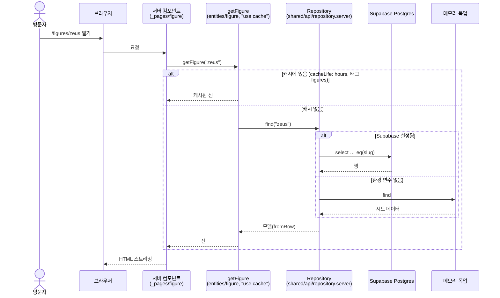
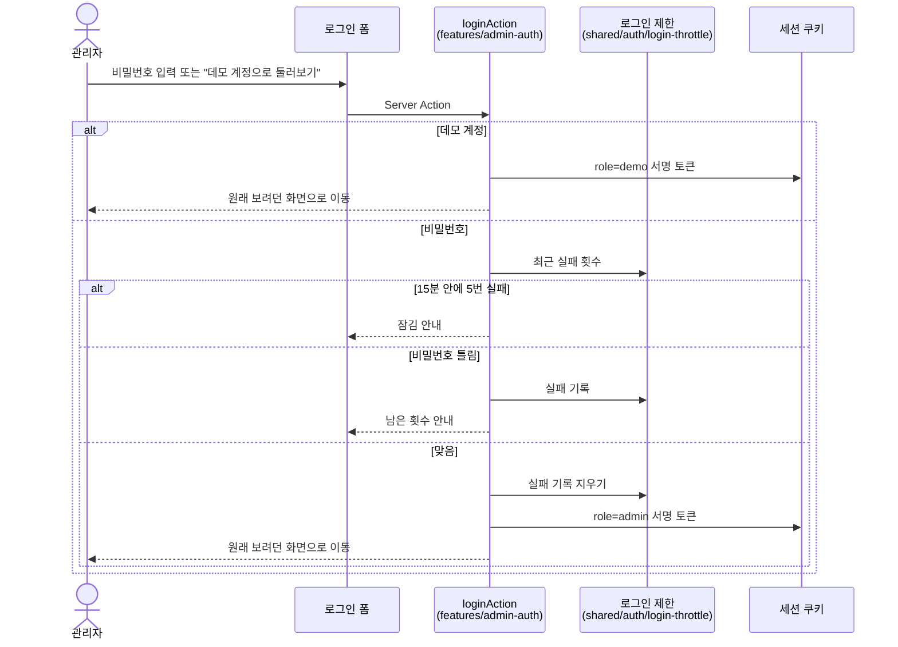
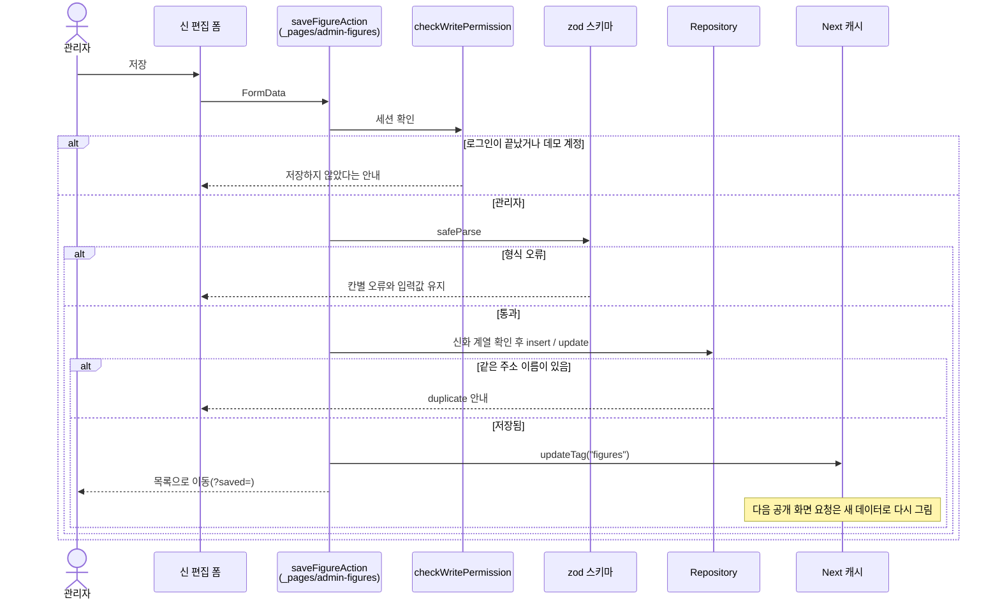
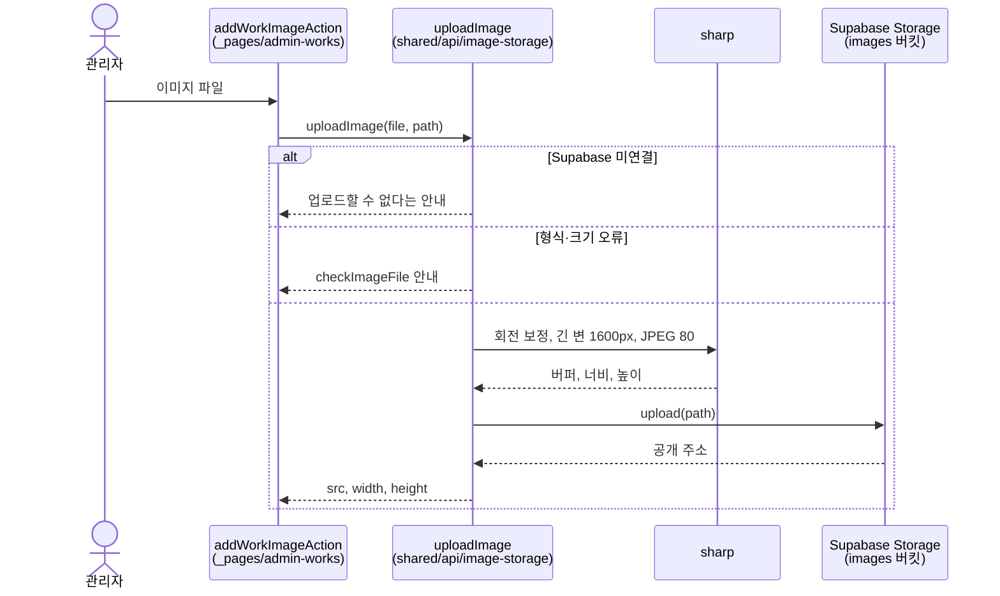

# 시퀀스 다이어그램

Ark의 주요 흐름입니다. 코드 위치는 `src/` 기준입니다.

## 1. 공개 화면 조회

신·계열·자료 화면은 서버 컴포넌트가 캐시된 조회 함수를 부릅니다. Supabase 환경 변수가 없으면 같은 모양의 메모리 목업이 답합니다.

## 2. 어드민 로그인

## 3. 어드민 저장과 공개 화면 갱신

## 4. 자료 이미지 업로드

매일 03:00(UTC)에는 Vercel Cron이 `/api/keep-alive`를 불러 무료 Supabase 프로젝트가 잠들지 않게 합니다.
